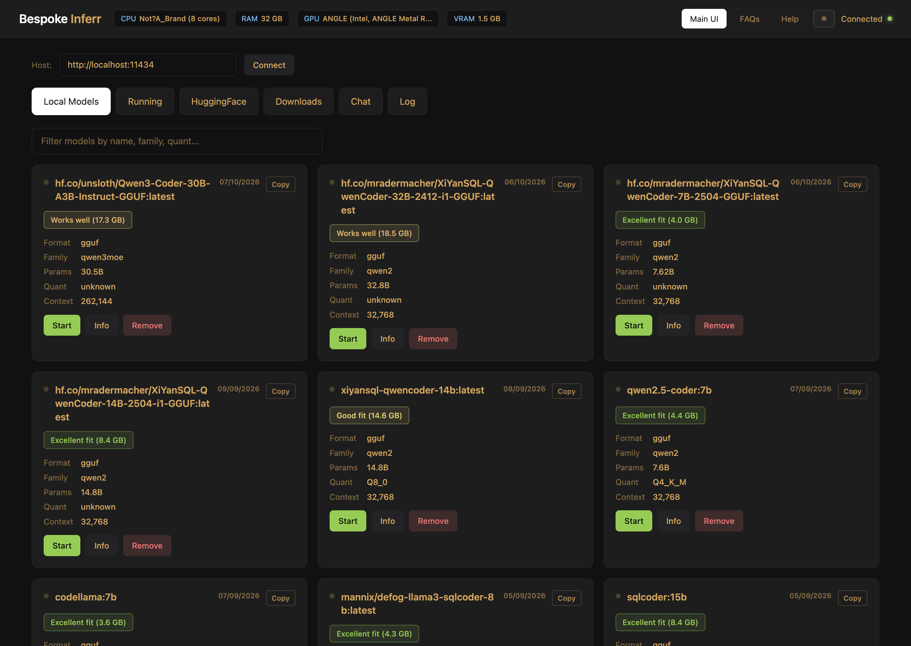
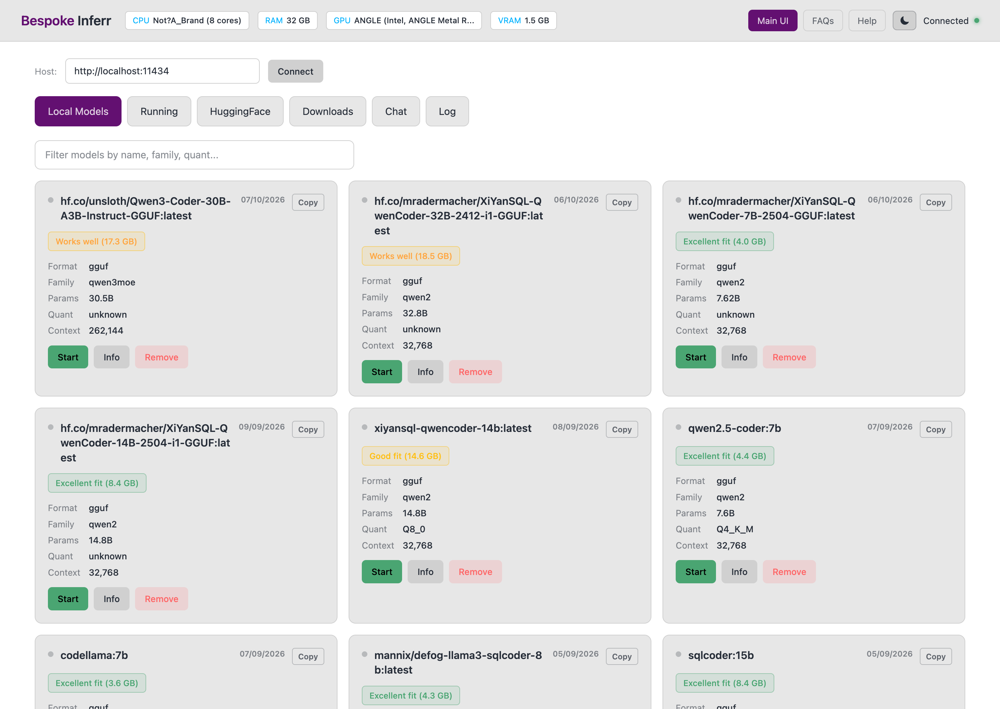
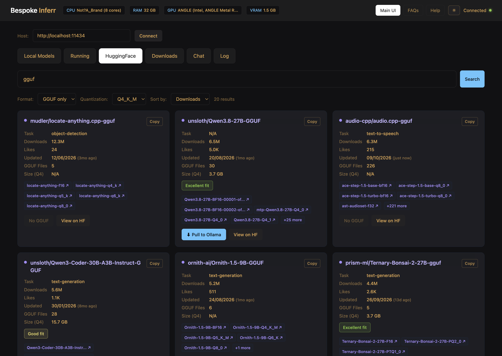

# Bespoke Inferr

[](LICENSE)
[](https://github.com/teescripts/bespoke-inferr/releases)


**Manage local LLMs without the bloat.** Bespoke Inferr is a free,
local-first manager for [Ollama](https://ollama.com) models — list,
pull, run, stop, and delete them from a native desktop app that ships
**under 5 MB**, not the 100–300 MB an Electron wrapper would cost you.

<p align="center">
  
</p>

## Why

- 🪶 **Tiny installs** — Windows x64 1.4 MB · macOS apps 612 - 364 KB ·
  Linux 1.2 MBs
- 🔌 **Local-first** — talks straight to your Ollama daemon at
  `localhost:11434`; no accounts, no cloud, no telemetry
- 🧠 **Hugging Face built in** — search HF and Ollama side by side,
  with hardware-fit badges before you download
- 🧹 **Partial-download cleanup** — stalled pulls are found and removed
- 🌗 **Dark/light themes** — dark by default, one toggle, persisted

## Download

Grab an installer from the
[GitHub Releases page](../../releases) — or take the small artifacts
straight from [`dist/`](dist/):

| Target | Artifact | Size |
|---|---|---|
| macOS Intel (x86_64) | `dist/macos-x86_64/Bespoke Inferr-mac-x64.zip` | 366 KB (612 KB app) |
| macOS Apple Silicon (arm64) | `dist/macos-arm64/Bespoke Inferr-mac-arm64.zip` | 364 KB (640 KB app) |
| Windows x64 | `dist/windows-x64/Bespoke Inferr 0.1.0_x64-setup.exe` | **1.4 MB** |
| Windows x86 | Releases only (97 MiB NW.js installer, gitignored) | 101 MB |
| Linux x86_64 | `dist/linux-x86_64/bespoke-inferr-linux-x64.tar.gz` | 1.2 MB |
| Linux ARM64 | `dist/linux-arm64/bespoke-inferr-linux-arm64.tar.gz` | 1.2 MB |

Sizes are measured from real builds; engine notes per target are in
[`dist/README.md`](dist/README.md). Requires a local
[Ollama](https://ollama.com) install (`ollama serve`).

## Quick start (web UI)

```bash
git clone https://github.com/teescripts/bespoke-inferr.git
cd bespoke-inferr
python3 scripts/server.py   # → http://localhost:8080/
```

Styling is Tailwind + daisyUI, built from one source file:

```bash
npm install                # first time
npm run build              # assets/app.css → assets/shared.css
```

<p align="center">
  
  &nbsp;
  
</p>

## Desktop builds

Ready-to-run artifacts live in [`dist/`](dist/) — one folder per
platform/architecture (per-target engine notes:
[`dist/README.md`](dist/README.md)).

All engines share one architecture:

- the pristine UI served from a **loopback HTTP server** — Ollama's
  CORS rejects `file://`/opaque origins, so every build serves the app
  from `http://127.0.0.1:<port>`
- server-side ports of the same API `server.py` exposes
- an Ollama lifecycle that **never touches an instance it didn't spawn**
  (spawn on demand, kill on quit only if this app started it)

## Repo layout

```
dist/            one folder per platform/arch target (downloads)
assets/          shared.css, theme.js, help content (source app.css)
images/          screenshots and brand assets
scripts/         server.py plus setup and run helpers
landing.html     public product page
```

## Contributing

Bug reports, fixes, and docs are welcome — see
[CONTRIBUTING.md](CONTRIBUTING.md) for the workflow and scope.

## Funding

If this saves you time,
[GitHub Sponsors](../../sponsors) and [Ko-fi](https://ko-fi.com/teehenry)
keep it moving — including a hardware test bench (128 GB RAM and
friends) so fit and performance claims get measured on more machines.

## License

[MIT](LICENSE) © 2026 teescripts — **code only**. The "Bespoke Inferr"
name, logo, and brand imagery are protected by
[TRADEMARK.md](TRADEMARK.md), so you can always tell the original from
a fork. Bundled third-party components keep their own licenses:
[THIRD_PARTY_NOTICES.md](THIRD_PARTY_NOTICES.md).
